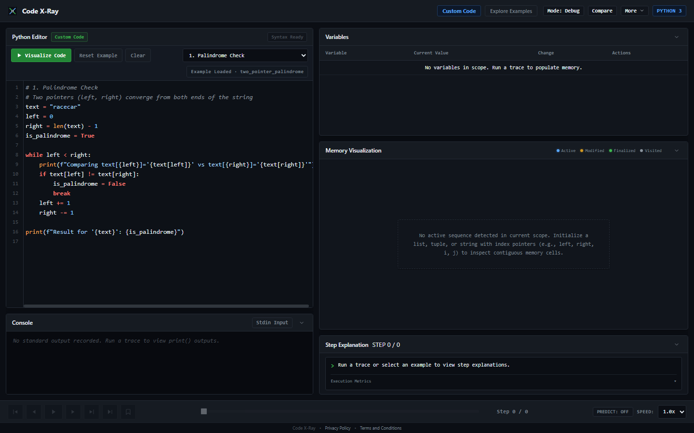
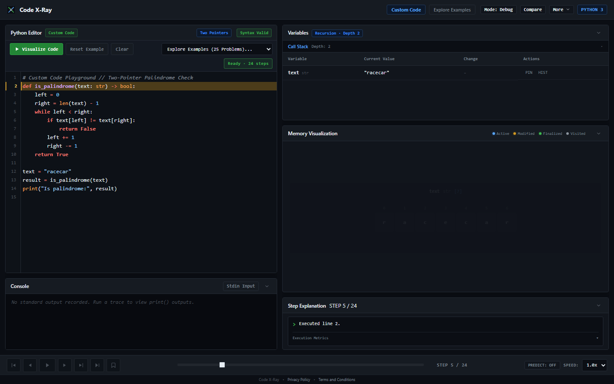

# Code X-Ray

Code X-Ray is an interactive Python execution visualizer and educational debugger for common Data Structures and Algorithms workflows. It combines line-level runtime tracing, AST-based recognition, step explanations, variable inspection, sequence and matrix visualization, and browser-based timeline playback.

## Features

- Editable Python editor powered by CodeMirror 5.
- Step-by-step execution, autoplay, speed control, timeline scrubbing, and captured standard output.
- Per-step local-variable snapshots, mutation information, sequence values, pointer candidates, call-stack information, and observed operation counters.
- AST-based recognition for supported patterns including sorting, searching, two pointers, sliding windows, matrix traversal, recursion, and generic code.
- Dedicated 1D sequence/pointer and 2D matrix stages.
- Eight primary semantic cell states: `neutral`, `active`, `visited`, `modified`, `discovered`, `found`, `finalized`, and `rejected`.
- Search success is shown only when runtime evidence confirms a match. Previously inspected search cells return to neutral; unsuccessful searches must not create a success highlight.
- Sorting finality is shown only when the trace proves a position final. Timeline scrubbing reverses future states.
- Learning and Debugging modes, step explanations, error diagnostics, predict-before-execute, algorithm comparison, custom test cases, glossary, and keyboard shortcuts.
- 25 preloaded Python examples covering two pointers, sliding windows, searching, sorting, matrices, stacks, queues, and recursion.
- JSON trace export/import and shareable code links.

Trace import restores serialized trace data. It is not a guarantee of 100% UI-state fidelity across application versions.

## Screenshots




## Technology

- Backend: Python, Flask, `sys.settrace`, and standard-library `ast`.
- Frontend: HTML5, CSS3, vanilla JavaScript.
- Editor: CodeMirror 5.
- Deployment: Vercel Python function at `api/index.py`, routed by `vercel.json`.
- Tests: Automated regression tests archived in local backup; verified with API smoke tests.

The production Python version is determined by deployment runtime configuration.

## Installation

Prerequisites: Python and Git.

```powershell
git clone https://github.com/Saqib-Hussain-xo/code-x-ray.git
cd code-x-ray
python -m venv .venv
.\.venv\Scripts\Activate.ps1
pip install -r requirements.txt
```

## Run locally

```powershell
python app.py
```

Open `http://127.0.0.1:5000`.

Optional local host/port:

```powershell
$env:PORT="8080"
$env:HOST="0.0.0.0"
python app.py
```

## Configuration and execution routing

| Variable | Default / behavior | Purpose |
|---|---|---|
| `PORT` | `5000` | Local Flask server port |
| `HOST` | `127.0.0.1` | Local Flask bind address |
| `XRAY_EXECUTION_MODE` | Trace route: `local`; health response fallback: `playground` | Execution mode |
| `XRAY_ALLOW_LOCAL_EXEC` | `true` | Allows custom code through the in-process tracer |
| `JUDGE0_API_URL` | Empty unless configured | Judge0 CE endpoint |
| `JUDGE0_API_KEY` | Empty unless required | Optional provider authentication |

The trace route defaults `XRAY_EXECUTION_MODE` to `local` and `XRAY_ALLOW_LOCAL_EXEC` to `true`, so custom code normally runs through `ExecutionTracer` inside Flask. The tracer uses a 1,000-step limit and a 2-second wall-clock limit.

For custom code, Judge0 is selected only when local execution is disabled, the mode is not `local`, and the app is not running tests. Configure `XRAY_ALLOW_LOCAL_EXEC=false`, a non-local `XRAY_EXECUTION_MODE` (such as `production`), and `JUDGE0_API_URL` (plus any required provider key). Allowlisted presets use the local tracer by design. Setting `XRAY_EXECUTION_MODE=production` alone does not disable local execution while `XRAY_ALLOW_LOCAL_EXEC=true`.

The health endpoint uses `playground` as its fallback mode value, while the trace route uses `local`.

## API overview

### `POST /api/trace`
Accepts custom source, e.g. `{"code":"print(1 + 1)","stdin":""}`, or an allowlisted preset, e.g. `{"preset_id":"bubble_sort"}`. Returns status, trace steps, captured output, and available recognition, complexity, and operation metrics. Optional fields vary by result.

### `POST /api/validate`
Accepts `{"code":"print('hello')"}` and performs Python AST syntax validation. Returns a validity flag and structured syntax-error details when applicable.

### `GET /api/presets`
Returns metadata for the 25 allowlisted presets. Do not assume it returns each preset's full source code.

### `GET /api/health`
Returns service status, application version, reported execution mode, preset count, and custom-code capability. The current application test expects version `1.2.0` and 25 presets.

### `POST /api/compare`
Accepts two implementations and returns execution results plus comparison information, including output agreement and observed operation deltas.

### `POST /api/batch-test`
Accepts source and test cases containing input and expected output. Returns per-case results and aggregate pass/fail counts.

For exact request validation and response fields, consult route implementations in `app.py` and corresponding tests.

## Tests

The automated regression test suite (12 root-level `test_*.py` modules, 131 tests) has been removed from the active repository to maintain a lean production footprint and is preserved in a local backup outside the repository. Application modules and endpoints can be verified via manual execution and API smoke tests against `http://127.0.0.1:5000` or the Vercel deployment.

## Security boundaries

- AST validation checks syntax; it is not a security sandbox.
- In-process step and time limits are application safeguards, not OS isolation.
- Python executed in-process must not be treated as safe for untrusted multi-tenant workloads.
- Use the configured remote Judge0 path for untrusted custom code and verify its environment configuration before public deployment.
- Request, output, and rate limits reduce abuse but do not replace process/container isolation.

## Limitations

- Dedicated visual stages: 1D sequence/pointer and 2D matrix, alongside variable and call-stack inspection.
- AST recognition does not imply a dedicated tree, graph, linked-list, or dynamic-programming visualizer.
- Complexity analysis is heuristic. Runtime counters describe one run and do not prove asymptotic complexity.
- Interactive input is supplied through predefined input data rather than a blocking terminal.

## Roadmap

Potential future work includes dedicated tree/graph stages, richer linked-list visualization, additional trace export formats, and multi-language execution. These are not current feature claims.

## License

Verify that a tracked `LICENSE` file exists before adding a license claim.
